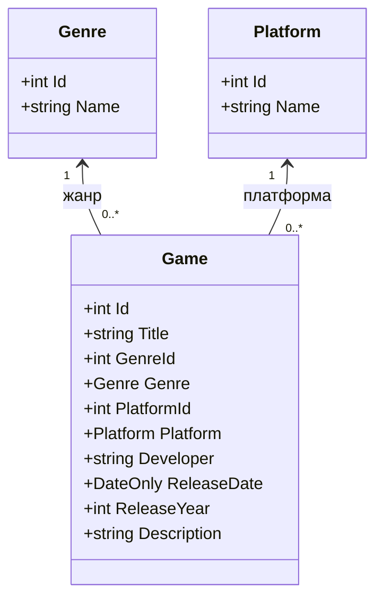
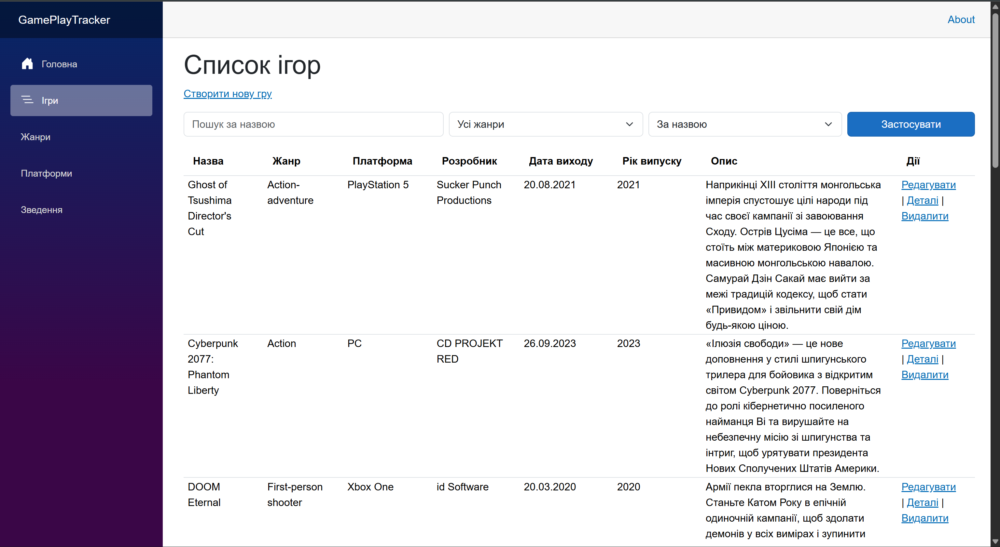
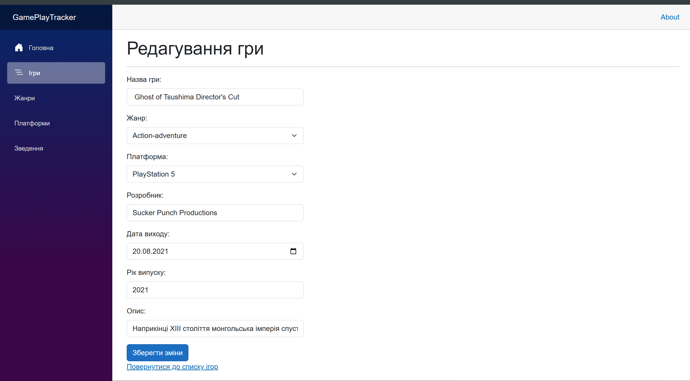
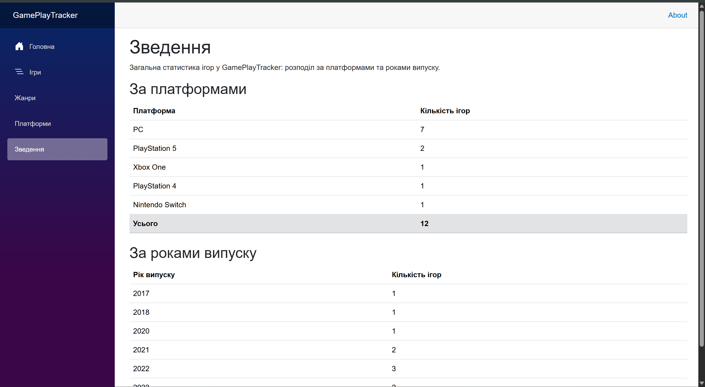

# GamePlayTracker

**Тема:** Облік проходження відеоігор: проходження, ігри, платформи; витрачений час і оцінки.

GamePlayTracker — вебзастосунок для обліку відеоігор. Він дає змогу зберігати інформацію про ігри, керувати жанрами та платформами, переглядати зведення й отримувати інформацію через REST API.

## Особливість проєкту

Основна ідея проєкту — надати можливість обліковувати проходження відеоігор та порівнювати два проходження за основними показниками, зокрема платформою, статусом проходження, витраченим часом, оцінкою та датами проходження.

## Технології

- C# та .NET 10.
- ASP.NET Core Blazor Interactive Server.
- Entity Framework Core.
- SQLite.
- LINQ.
- REST API та OpenAPI.
- Scalar.
- xUnit для модульного тестування.

## Діаграма класів



## Основний функціонал

- Перегляд списку відеоігор.
- Додавання, редагування та видалення ігор.
- Керування жанрами та платформами.
- Пошук ігор за назвою.
- Фільтрація за жанром.
- Сортування за назвою, роком випуску та датою виходу.
- Пагінація списку ігор.
- Перегляд детальної інформації про гру.
- Формування зведень за платформами та роками випуску.
- Перевірка введених даних і запобігання дублюванню ігор.

## Вебсервіс (API)

У проєкті реалізовано REST API для отримання інформації про відеоігри та загального зведення.

### Доступні ендпоїнти

| Метод | Маршрут | Призначення |
|---|---|---|
| GET | `/api/games` | Отримання списку всіх ігор |
| GET | `/api/games/{id}` | Отримання інформації про гру за її ID |
| GET | `/api/summary` | Отримання загальної кількості ігор та розподілу за платформами |

Усі відповіді API повертаються у форматі JSON. Для представлення даних гри використовується DTO `GameDto`, що відокремлює зовнішнє представлення даних від внутрішніх моделей бази даних.

Якщо гра з указаним ID не знайдена, API повертає статус `404 Not Found`.

### Документація API

Для документування API використовується OpenAPI, а для перегляду та тестування ендпоїнтів — Scalar.

- **Scalar:** `http://localhost:5142/scalar`
- **OpenAPI JSON:** `http://localhost:5142/openapi/v1.json`

Документація API доступна в середовищі розробки.

### Перевірка запитів

Для перевірки роботи API використовується файл `GamePlayTracker.http`, який містить запити для отримання списку ігор, окремої гри, перевірки відсутнього запису та отримання зведення.

## Конфігурація застосунку

Основні параметри застосунку зберігаються у файлі `GamePlayTracker/appsettings.json`.

- `ConnectionStrings:Default` — рядок підключення до бази даних SQLite.
- `GamePlayTracker:PageSize` — кількість ігор, які відображаються на одній сторінці.
- `GamePlayTracker:Title` — назва застосунку в навігаційному меню.

Параметри журналювання налаштовані в секції `Logging`. Для зменшення кількості повідомлень про виконання SQL-команд Entity Framework Core використовується відповідний рівень журналювання `Warning`.

## Журналювання та міграції

Для журналювання операцій створення, редагування та видалення ігор використовується `ILogger`.

Під час запуску застосунку автоматично перевіряється та оновлюється схема бази даних за допомогою `Database.MigrateAsync()`. Це дає змогу застосовувати наявні міграції Entity Framework Core без ручного виконання команд.

Якщо запис гри не знайдено, сторінки перегляду, редагування та видалення відображають відповідне повідомлення українською мовою.

## Вимоги

Для запуску проєкту необхідні:

- .NET 10 SDK.
- Git (для клонування репозиторію).

База даних SQLite створюється та оновлюється автоматично під час запуску застосунку завдяки налаштованому механізму міграцій.

## Запуск проєкту

1. Клонувати репозиторій:

```bash
git clone <URL-репозиторію>
```

2. Перейти до каталогу проєкту:

```bash
cd GamePlayTracker
```

3. Відновити залежності:

```bash
dotnet restore
```

4. Запустити застосунок:

```bash
dotnet run --project GamePlayTracker/GamePlayTracker.csproj
```

5. Відкрити адресу, зазначену в консолі після запуску.

Під час першого запуску застосунок автоматично застосує міграції та підготує базу даних SQLite.

## Тестування

Для запуску модульних тестів необхідно виконати команду з кореневого каталогу репозиторію:

```bash
dotnet test
```

Тести перевіряють роботу класу `SummaryCalculator`, зокрема групування ігор за платформами та роками, підрахунок кількості записів і обробку порожньої вибірки.

У межах лабораторної роботи № 12 реалізовано шість тестів, усі вони пройшли успішно.

## Публікація застосунку

Для створення Release-версії потрібно перейти до каталогу основного проєкту:

```bash
cd GamePlayTracker
```

Виконати публікацію:

```bash
dotnet publish -c Release -o ./publish
```

Опублікований застосунок можна запустити командою:

```bash
cd publish
dotnet GamePlayTracker.dll
```

База даних SQLite має бути доступною за шляхом, указаним у рядку підключення. Якщо файл бази даних не потрапив до каталогу публікації автоматично, його потрібно скопіювати туди вручну.

## Контейнеризація

У корені репозиторію розміщено `Dockerfile`, призначений для контейнеризації застосунку з використанням офіційних образів .NET 10.

Передбачено:
- окремі етапи збирання та запуску;
- запуск застосунку в контейнері на порту `8080`;
- збереження бази SQLite у окремому томі `/app/data`.

Для збирання Docker-образу:

```bash
docker build -t gameplaytracker .
```

Для запуску контейнера:

```bash
docker run -d -p 8080:8080 -v gameplaytracker-data:/app/data --name gameplaytracker gameplaytracker
```

Після запуску застосунок буде доступний за адресою `http://localhost:8080`.

**Примітка:** фактичне збирання та запуск Docker-контейнера не перевірялися через відсутність Docker Desktop у середовищі розробки.

## Скріншоти застосунку






