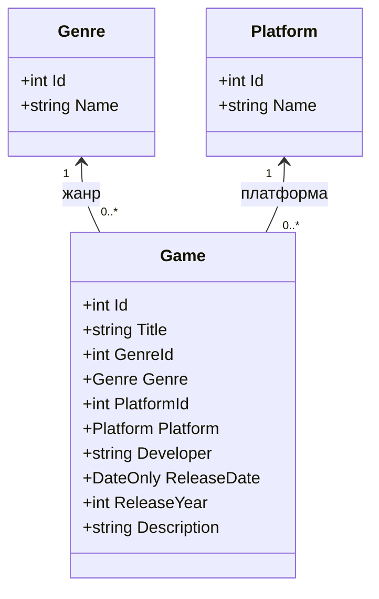
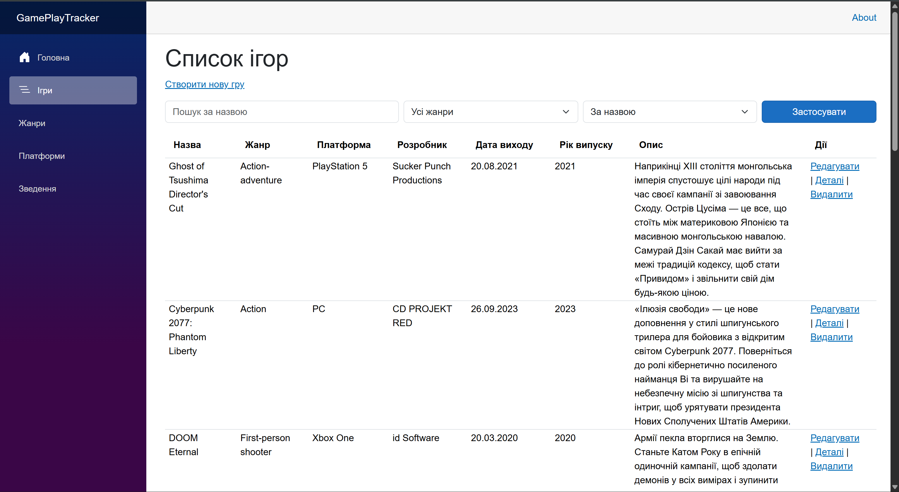
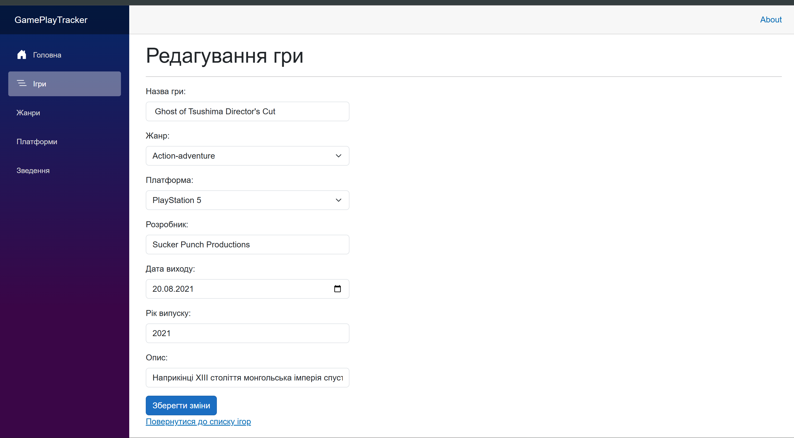
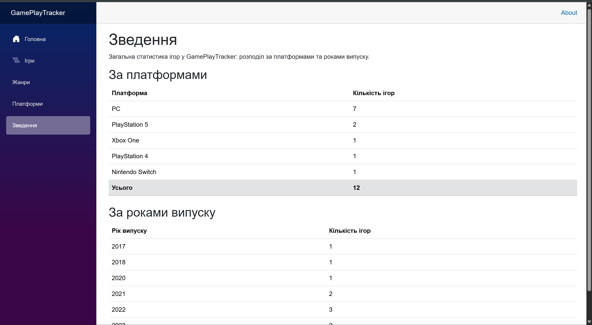

# GamePlayTracker

**Тема:** Облік проходження відеоігор: проходження, ігри, платформи; витрачений час і оцінки.

GamePlayTracker — вебзастосунок для обліку проходження відеоігор. Застосунок дає змогу зберігати інформацію про ігри, платформи та проходження, а також вести облік витраченого часу й оцінок. Він призначений для користувачів, які хочуть зручно вести власну історію проходження відеоігор.

## Особливість проєкту

Застосунок матиме можливість порівнювати два проходження відеоігор за основними показниками, зокрема платформою, статусом проходження, витраченим часом, оцінкою та датами проходження. Це дасть змогу переглядати характеристики двох записів поруч і бачити відмінності між ними без необхідності порівнювати дані вручну.

## Діаграма класів

