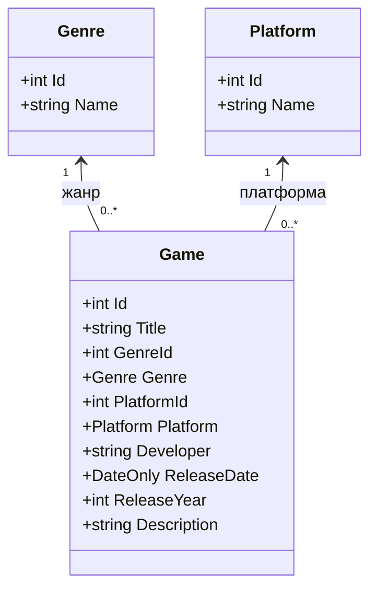
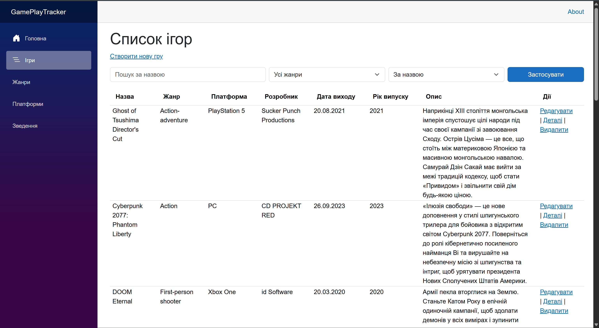
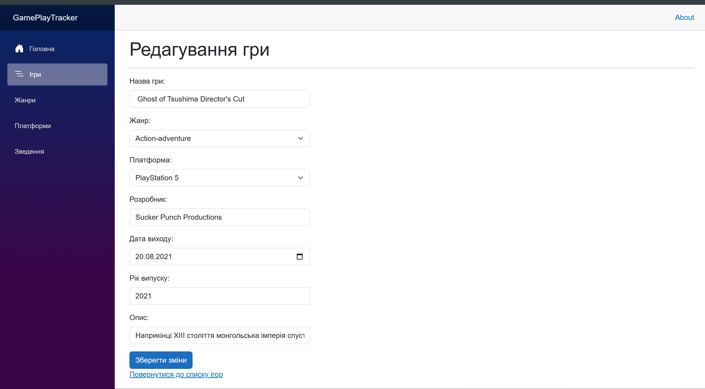
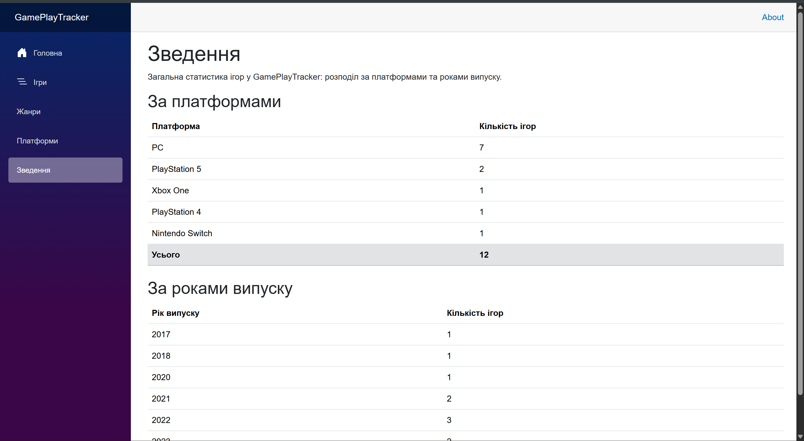

# GamePlayTracker

**Тема:** Облік проходження відеоігор: проходження, ігри, платформи; витрачений час і оцінки.

GamePlayTracker — вебзастосунок для обліку проходження відеоігор. Застосунок дає змогу зберігати інформацію про ігри, платформи та проходження, а також вести облік витраченого часу й оцінок. Він призначений для користувачів, які хочуть зручно вести власну історію проходження відеоігор.

## Особливість проєкту

Застосунок матиме можливість порівнювати два проходження відеоігор за основними показниками, зокрема платформою, статусом проходження, витраченим часом, оцінкою та датами проходження. Це дасть змогу переглядати характеристики двох записів поруч і бачити відмінності між ними без необхідності порівнювати дані вручну.

## Діаграма класів

## Вебсервіс (API)

У проєкті реалізовано REST API для отримання інформації про відеоігри та загального зведення.

### Доступні ендпоїнти

| Метод | Маршрут | Призначення |
|---|---|---|
| GET | `/api/games` | Отримання списку всіх ігор |
| GET | `/api/games/{id}` | Отримання інформації про гру за її ID |
| GET | `/api/summary` | Отримання загальної кількості ігор та розподілу за платформами |

Усі відповіді API повертаються у форматі JSON. Для представлення даних гри використовується DTO `GameDto`, що відокремлює зовнішнє представлення даних від внутрішніх моделей бази даних.

Якщо гра з указаним ID не знайдена, API повертає статус `404 Not Found`.

### Документація API

Для документування API використовується OpenAPI, а для перегляду та тестування ендпоїнтів — Scalar.

- **Scalar:** `http://localhost:5142/scalar`
- **OpenAPI JSON:** `http://localhost:5142/openapi/v1.json`

### Перевірка запитів

Для перевірки роботи API використовується файл `GamePlayTracker.http`, який містить запити для отримання списку ігор, окремої гри, перевірки відсутнього запису та отримання зведення.

## Скріншоти застосунку

